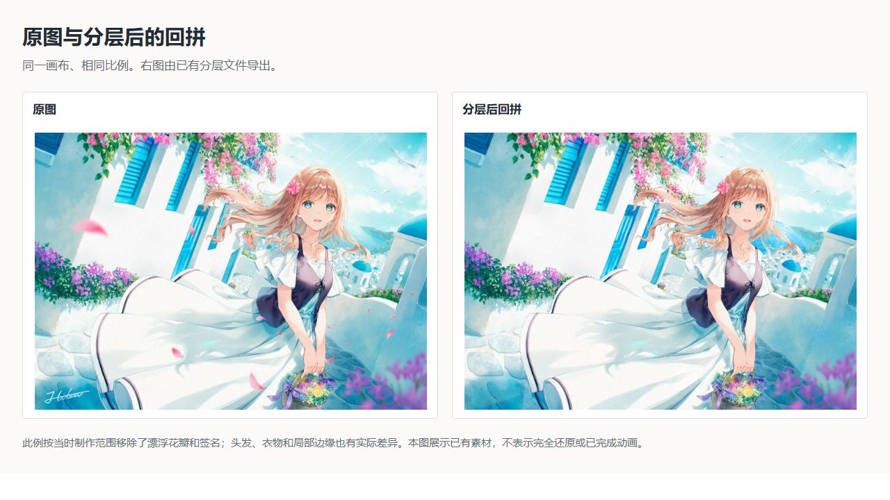
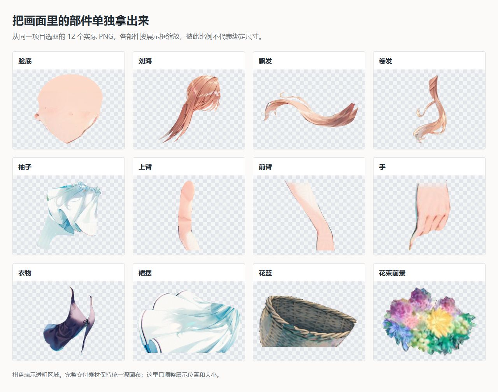
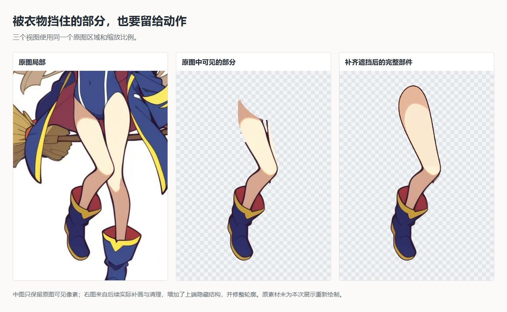
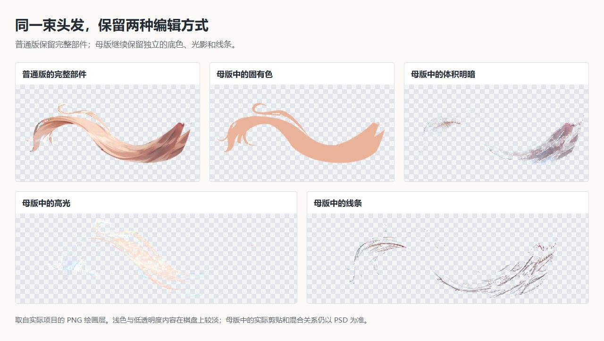

# 用于L2D和Spine的插画分层及补画技能

> 为 Live2D、Spine 动画制作准备分层素材的 Codex 技能。

[效果展示](#效果展示) · [交付内容](#会交付哪些文件) · [安装使用](#在-codex-中使用) · [反馈与维护](#反馈与维护) · [GPL-3.0](LICENSE)

准备做动画时，手里常常只有一张合好的插画或人物立绘。头发能抠出来，头发下面的脸却未必完整；手臂一抬，袖口、身体和投影的接缝才显出来。很多返工就藏在这些原本看不见的地方。

这套技能是从之前的拆图项目里整理出来的。我们给头发分过底色和光影，也补过被衣物截断的腿部底片。希望把这些制作前的准备做得更踏实一些，让动画师拿到 PSD 后，能把精力放回动作上，少一些做到一半又回去补图的来回折腾。

你提供原图，告诉 Codex 哪些地方要动、大致动到什么程度。它会先整理分层方案，再结合图像工具拆件、补画、对位，并到图层软件里检查拼合和移动后的样子。正式的网格、骨骼、参数和动画，留在 Live2D 或 Spine 中继续制作。

## 效果展示

### 从一张成图，到能单独取用的部件

下面是之前项目留下的实际素材。左边是原图，右边是拆分后重新拼合的预览，可以直接比较整体有没有走样。



这个案例按当时的需求移除了飘落花瓣和签名，头发、衣物的部分细节也有差异。它展示的是当时的制作结果；完成度仍要结合单层和动作检查判断。

再把其中一些部件单独摆出来，就能看到 PSD 里实际能拿到什么：脸、发束、袖子、手臂、手、裙子、花篮等各有自己的素材。



这里为了看清轮廓，分别缩放了展示大小。用于组装的 PNG 保留统一画布和原来的位置，动画师不需要照着这张展示图重新拼摆。

### 把挡住的部分补完整

下面这条腿，初次提取时只保留了原图中露出的部分。上端沿着衣物的遮挡边被截断，移动前景后，缺口就会露出来。后续补画延长了腿部底片，让它能接到遮挡后方。



这也是技能会反复检查的地方：移开头发看脸底，移开袖口看手臂，单独查看根部和接头。底片要覆盖约定动作会露出的区域，边缘也不能粘着邻件的颜色或旧遮挡线。

补画范围取决于动作。轻微摆动和大幅转身需要的素材差别很大；单张图没有画出的结构，需要参考原画推断，拿不准的地方会留出来说明。

### 底色与光影分开，后面才好调整

假如头发已经移开，投在脸上的阴影还留在脸底上，动作就容易显得不对。换色、调整受光或移动投影，也都需要能单独取用的绘画层。

因此，**这套技能要求每个项目都分离固有色与光影**。固有色可以简单理解为物体本身的颜色。线条、纹理、阴影和高光按画面里实际存在的内容保留，投影还要说明落在哪个部件上、由谁遮挡形成。



图中使用的是之前项目的真实绘画层。透明度和混合关系会影响最终观感，单层预览用于看清拆分内容，完整效果以 PSD 中的实际组装为准。

## 会交付哪些文件

每个项目都交付两份与原图同画布的 RGB、8 位 PSD：

| 文件 | 什么时候用 |
| --- | --- |
| **可编辑母版** | 需要继续修图、改色或调整光影时使用。固有色、描线、纹理和光影保持独立，保留实际用到的蒙版、剪贴和混合关系。 |
| **普通图层版** | 作为导入 Live2D、Spine 的起点。同一动画绘制段内的绘画层合成普通透明像素层；需要独立运动的部件、底片、前后遮挡段、表情和光影仍然分开。 |

此外会保留部件素材、回拼预览和一份简明说明，写清哪些动作检查过、哪里还需要处理、是否在目标软件中实际导入过。有背景的原图会单独保留背景，透明原图保持透明。

前面的图片来自两个既有项目，用来展示拆分与修补。它们没有完成 Live2D／Spine 的实际导入和绑定验证，其中花篮插画还留有最终桌面验收待办。随包脚本可以生成动作诊断预览；正式制作仍需在目标软件中检查。

## 在 Codex 中使用

这是给 Codex 读取的技能，里面包含制作方法和辅助脚本。完整流程需要：

- 可用的图像生成／编辑工具，用来补画和清理素材。
- 桌面操作工具，以及 Photoshop。随包的 PSD 组装脚本使用 ExtendScript，需要能执行它的连接或工具。
- Python 3.10+、Pillow 和 NumPy，用来处理素材、对位和生成检查图。
- 需要实际导入验收时，还要有对应版本的 Live2D Cubism 或 Spine。

图像服务、桌面控制器和 Photoshop 需要在自己的环境中准备。第一次使用时，可以先让 Codex 检查这些工具是否可用。组装脚本负责导入普通像素层；母版需要的剪贴、蒙版和特殊混合，由 Codex 通过可用的 Photoshop 工具实际建立并检查。

### 安装

在 Codex 中发送：

```text
$skill-installer 请从 https://github.com/ChitoseRen/semantic-illustration-layers 的仓库根目录安装技能，名称为 semantic-illustration-layers。
```

也可以把整个仓库下载为 `semantic-illustration-layers` 文件夹，放入个人技能目录 `~/.agents/skills/`，让 `SKILL.md` 位于该文件夹根部。已有同名技能时先备份。安装后如果没有出现在技能列表中，重启 Codex 再查看。目录与发现方式见 [Codex 官方技能说明](https://learn.chatgpt.com/docs/build-skills)。

脚本依赖列在 [`scripts/requirements.txt`](scripts/requirements.txt)。可以让 Codex 在现有 Python 环境中检查它们，或在技能目录建立独立环境：

```powershell
python -m venv .venv
.\.venv\Scripts\python.exe -m pip install -r scripts/requirements.txt
```

macOS、Linux 对应使用 `python3 -m venv .venv` 和 `.venv/bin/python -m pip install -r scripts/requirements.txt`。

### 给它一张图，说明想做的动作

例如：

```text
使用 $semantic-illustration-layers 为这张立绘准备 Live2D 素材。
我希望头部能小幅转动，前发和后发能摆动，并能眨眼、张嘴。
请保留原画的线条、配色和光影，交付可编辑母版和普通图层版 PSD。
先给我看拆件方案，说明哪些遮挡需要补画，确认后再开始。
```

如果用于 Spine，就说明关节、附件和动作范围，例如抬手、身体起伏或道具摆动。用平时讨论动画的说法即可，不必先整理成脚本参数。有些图只需有限的动作，有些需要更多角度或表情，拆分范围会跟着需求调整。

开始前会先核对原图与方案；已有确认过的方案或明确的直接执行授权，可以继续沿用。制作中先试做一个难点，再逐步扩展。最后要分别重开两份 PSD，查看单层、切换状态、移动部件，并对照原图。工具暂时无法完成的检查，会如实留在交付说明中。

<details>
<summary>想了解具体做法：制作方法与脚本说明</summary>

[`SKILL.md`](SKILL.md) 是 Codex 执行时读取的入口。更细的操作按需要查看：

- [材质分层](references/material-layers.md)、[面部拆分](references/face-parts.md)
- [原图保留与补画](references/source-reconstruction.md)、[透明度与对位](references/alignment-review.md)
- [动作诊断](references/motion-tests.md)、[验收标准](references/quality.md)
- [PSD 导出与软件导入](references/psd-export.md)、[项目数据格式](references/schema.md)

</details>

## 反馈与维护

如果你觉得这套技能好用，愿意在仓库右上角点一下 [Star](https://github.com/ChitoseRen/semantic-illustration-layers) 吗？谢谢你的支持。

用过以后，也欢迎到 [Issues](https://github.com/ChitoseRen/semantic-illustration-layers/issues) 聊聊你的使用体验和改进建议。哪一步用着顺手，哪里还得反复返工，或者有什么希望补上的功能，都可以直接说，不用整理得很正式。

我会持续维护这套技能，修复使用中发现的问题，也会继续改进流程和说明文档。

## 许可证

Copyright (C) 2026 ChitoseRen。

本项目的技能说明、文档和辅助脚本采用 [GNU GPL v3.0](LICENSE)（`GPL-3.0-only`）发布。

示例图片用于展示处理效果，原始插画及其素材的权利归各自权利人所有，不包含在上述授权中。
